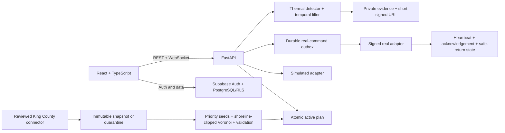

# Architecture and algorithms

LakeSafe separates public awareness, station operations, planning inputs, simulated
coordination, and the unvalidated real-device seam. That separation is a safety property:
a public client cannot obtain an operational row by asking for a more detailed version
of the same endpoint, and a simulated command cannot enter the real transport adapter.

## Application and authorization layers

The React/TypeScript dashboard calls FastAPI REST endpoints, and the backend exposes two
different WebSocket surfaces. The current civilian dashboard reads dedicated public
projection tables through REST; it does not currently connect to the public WebSocket.
The available anonymous public WebSocket rejects URL credentials and can broadcast a
`PublicPatrolPresence` payload after DTO validation enforces its fields and minimum
publication delay. The broadcast helper does not query the database or prove that its
caller supplied a persisted row. The current dashboard operations page connects to the
authenticated operational WebSocket. Operational REST and WebSocket routes verify a
Supabase token, reload the principal's current authority, and require the lake's station
plus the relevant role capability. The operational socket carries its bearer value as a
negotiated subprotocol, rejects query-string credentials, and periodically revalidates
access.

An operational principal must be an officer with current verification, MFA assurance
level `aal2`, active station membership, and an allowed role. Roles map to narrow
capabilities such as reading operations, managing alerts, changing simulated circulation,
or managing inventory. Supabase row-level-security policies enforce station ownership in
addition to application checks. Recent MFA is required for selected high-impact actions.

## Reviewed input, immutable snapshot, and quarantine

The reviewed connector joins King County Freshwater Swim Beach Data (`mbzm-4r9y`) to
Water Quality Monitoring Sites (`e9bt-i75a`) by a fixed reviewed locator set. It uses
deterministic selected fields, filters, ordering, timezone normalization, schema checks,
and provenance. These are public access/environmental observations, not emergency-event
records.

Connector results are canonicalized and sorted into an immutable snapshot, including
source versions, attribution, raw publisher payload, normalized time, provenance, and a
SHA-256 digest. A fetch, schema, or connector failure produces a quarantined snapshot
with no invented points. It does not silently switch to demo data, and the last active
plan remains intact.

## Exact source coordinates versus derived operational seeds

The snapshot preserves the publisher's exact monitoring latitude/longitude in both the
normalized point and provenance. Planning treats those coordinates as evidence, not as
automatically valid navigational positions. A reviewed monitoring site can be on shore or
just outside the official water polygon. For a reviewed catalog source within the bounded
near-shore tolerance, the planner finds the nearest official shoreline in a local metric
projection and moves the operational seed five metres inside the polygon. Provenance
records the exact source coordinate, derived seed coordinate, adjustment distance, and
reason (`projected_inside_official_shoreline`). A source outside the reviewed tolerance
fails closed. Thus the source fact is never rewritten, while the derived seed is safe for
polygon partitioning and visibly proxy-labeled.

## Deterministic shoreline-clipped planning

Non-proxy incident clustering remains a separate algorithmic seam, but there is currently
no reviewed incident connector configured. Reviewed access/environment proxy locations
therefore enter directly as priority seeds. The planner preserves every priority seed,
then adds farthest-point geometric coverage seeds according to available patrol capacity
and reserve policy. It builds Voronoi regions in a latitude-scaled local plane, clips them
to the reviewed King County shoreline, selects interior patrol centers, applies radius
limits, and validates coverage and geometry. Candidate plans are persisted before a
compare-and-swap activation changes the one active-plan pointer, preventing concurrent
refreshes from overwriting a newer plan.

## Simulation and real-device boundary

Simulation uses a separate adapter and inventory source. Real commands use durable,
versioned, idempotent outbox envelopes and an isolated real adapter that accepts only
real inventory owned by the same station and lake. The backend signs outbound gateway
payloads with HMAC using a backend-only secret reference. Device-to-server requests use
separate signed credentials, bounded clock skew, and replay-resistant sequences.

Gateway acceptance does not mark a real assignment active. A matching ordered device
acknowledgement advances state transactionally; rejection or expiry cannot become active.
Heartbeat freshness, health, connectivity, maintenance, and battery affect eligibility.
Retry expiry, lost capacity, or gateway failure can degrade/stop autonomy and request
safe return. This pathway exists in software but has not been physically flight-validated.

## Thermal and evidence path

`ThermalDetector` converts a single-channel frame for an Ultralytics model and emits
bounded detection records. `TemporalPersistenceFilter` requires spatially overlapping
detections across consecutive frames before emission. This is implemented code, not
proof of open-water accuracy. Operational thermal clips are kept in a private Supabase
bucket. The backend checks officer/station/capability access and emits an audited signed
URL with a maximum lifetime of 60 seconds; browser credentials cannot directly read the
bucket.
